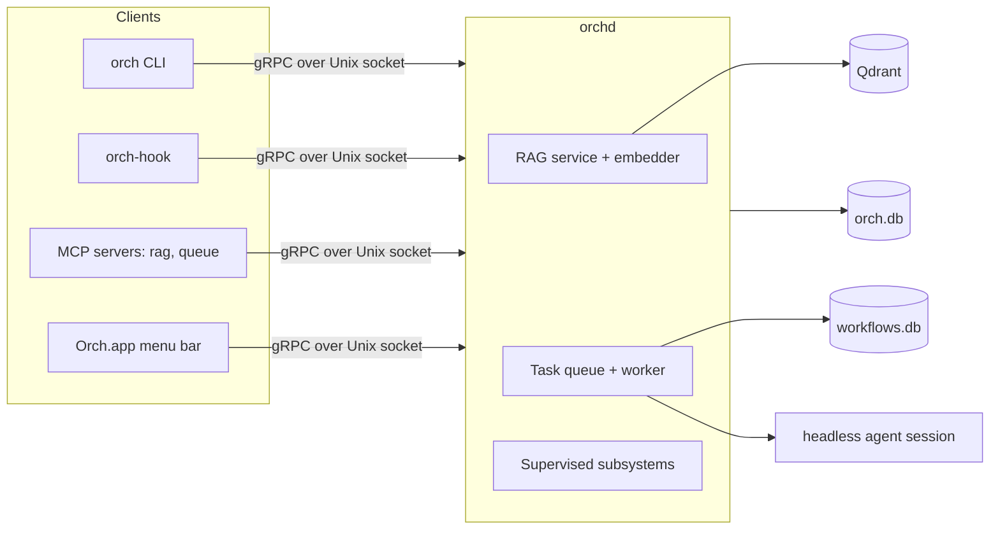

# Architecture

## Why

Coding agents start every session with no memory, and each harness (Claude Code, Codex, Gemini)
has its own configuration. orch gives them one shared memory and one set of instructions, kept on
your machine, and lets them hand work to background sessions that survive restarts.

Design principles:

- **Local-first.** Embedding, storage and scheduling run locally. Captured sessions and
  refreshed sources are redacted of secrets before they are indexed.
- **One owner for long-lived state.** A single daemon holds the model, the vector store and the
  queue, so clients stay fast and stateless.
- **Agent-neutral.** Shared policy and memory work the same in every harness; harness-specific
  wiring lives in adapters.
- **Safe by default.** Installs preview before applying and back up what they change; nothing
  routes work to a new model or runs tasks unattended until you enable it.

## Components

| Binary | Role |
|---|---|
| `orchd` | Daemon. Serves gRPC on a Unix socket and runs every long-lived subsystem. |
| `orch` | CLI: search, ingest, dispatch, install, status, config. Also runs the MCP servers (`orch mcp`). |
| `Orch.app` | macOS menu bar app (Swift, in `macos/`): daemon health and control. A client like `orch`; it never opens the databases. See [internals/app.md](internals/app.md). |
| `orch-hook` | Called by the harness on lifecycle events. Does only local work and hands anything slow (storing transcripts and edited docs, refreshing PRs) to `orchd`. |

`orchd` supervises these subsystems, each restartable on its own (`orch restart <name>`):
`qdrant`, `workflow-worker`, `sources-scheduler`, `docs-scheduler`, `pr-babysitter`,
`routing-evaluator`, `handoff`, `session-summarizer`, `self-update`.

## How data flows

**Ingest.** Text arrives from the CLI, MCP, hooks, or the schedulers that refresh registered
repos and web sources; hooks and schedulers redact secrets first. `orchd` splits it into
token-sized chunks, embeds each one, adds a BM25 keyword vector, and writes both to Qdrant.
Every write goes through one code path (`rag.Service.IngestText`).

**Search.** A query runs a semantic and a keyword search in parallel and merges them with
reciprocal rank fusion. Each hit keeps its cosine score so relevance floors stay meaningful.

**Sessions.** On each prompt, `orch-hook` searches memory (current project first) and adds the
best hits to the prompt. At session end it writes the session record and hands the transcript
to `orchd`, which stores it redacted in the background and later replaces the record with a
model-written summary.

**Tasks.** `orch dispatch` or the `queue_dispatch` tool records a durable workflow. The worker
runs it as a headless agent session, optionally verifies the result by running the repo's tests,
and records the outcome. Routing picks the model per task kind from the models you have enabled.

## Where state lives

| Path | Contents |
|---|---|
| `~/.config/orch/config.yaml` | Settings (`orch config set`); defaults are compiled in |
| `~/.config/orch/AGENTS.md`, `policy/` | Shared agent policy installed from this repo |
| `~/.local/share/orch/orch.db` | SQLite: tasks, sources, model registry, routing |
| `~/.local/share/orch/workflows.db` | Durable workflow state for the task queue |
| `~/.local/share/orch/qdrant/` | Vector store (Qdrant runs natively, no Docker) |
| `~/.local/share/orch/models/` | Embedding model (MiniLM, ONNX) |
| `~/.local/share/orch/sessions/`, `events/` | Session records and per-stream event logs |
| `~/.local/share/orch/handoff/` | Work hooks left for `orchd`; kept until done |
| `~/.local/share/orch/orchd.sock` | The daemon's socket |

`ORCH_CONFIG_DIR` and `ORCH_DATA_DIR` override these locations.

## Package map

Entry points are in `cmd/`; everything else is under `internal/`. The macOS app is a separate
Swift package in `macos/`.

| Area | Packages |
|---|---|
| Daemon and RPC | `daemon`, `rpc/orchdv1` (generated from `orchd.proto`), `orchdclient`, `supervisor`, `selfupdate` |
| Memory | `rag` (chunk, embed, store, search, migrate), `embed`, `bm25`, `qdrant`, `redact`, `rageval` |
| Sources | `sources` (registry and freshness), `docs` (GitHub repos), `mdwalk`, `session`, `summarize`, `handoff` |
| Tasks and routing | `queue`, `workflows`, `agentrun`, `models`, `routing`, `evidence`, `taskfmt` |
| Harness integration | `install` (adapters, shipped agents, skills and policy), `safetynet` (cc-safety-net pin, detection and guard rules), `settings` (managed Claude Code and cc-safety-net settings, their store and reconciler; [internals/settings.md](internals/settings.md)), `hook`, `mcpserver` |
| CLI and status | `cli`, `status`, `check` |
| Infrastructure | `config`, `paths`, `db`, `events`, `prs`, `model`, `version` |

## Internals

[internals/](internals/README.md) documents each part in implementation depth: the RPC API,
storage layout and payload schema, chunking and ranking algorithms, hook protocol, adapters,
configuration, and a build order for a re-implementation.

## Design history

Plans that shaped the code, kept for context; the code is the source of truth:
[GO_REWRITE_PLAN.md](GO_REWRITE_PLAN.md), [MODEL_ROUTING_PLAN.md](MODEL_ROUTING_PLAN.md),
[RAG_SENSITIVITY_PLAN.md](RAG_SENSITIVITY_PLAN.md).
